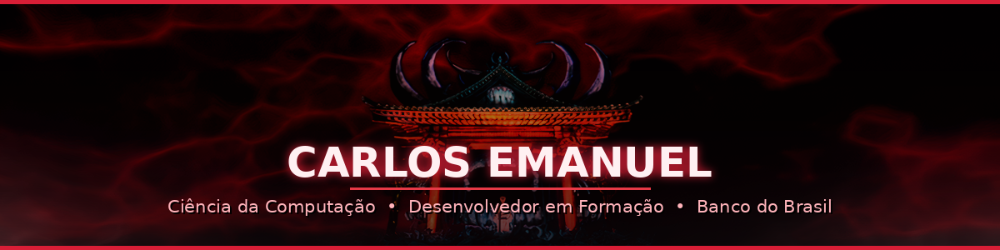

<div align="center">
  
</div>

<div align="center">
  <a href="https://git.io/typing-svg">
    
  </a>
</div>

<div align="center">
  <a href="https://www.linkedin.com/in/carlos-emanuel-da-silva-santos/" target="_blank">
    
  </a>
  <a href="https://instagram.com/carlosemanuel.03" target="_blank">
    
  </a>
  <a href="https://discord.com/users/lumitz1" target="_blank">
    
  </a>
</div>

<br />

---

### ⛩️ Sobre Mim


```yaml
nome: "Carlos Emanuel da Silva Santos"
localizacao: "Brasília - DF, Brasil 🇧🇷"
atuacao: "Estagiário no Banco do Brasil 🏦"
formacao: "Ciência da Computação - UDF 🎓"
foco:
  - "Desenvolvimento Back-end & Web"
  - "Estrutura de Dados & Banco de Dados"
  - "Aprendizado Contínuo"
```

- 🔭 Atualmente atuando como **Estagiário no Banco do Brasil** e desenvolvendo projetos acadêmicos e pessoais.
- 🌱 Aprimorando conhecimentos em **Python, PHP, SQL e Desenvolvimento Web**.
- 🔥 Sempre em busca de novos desafios para evoluir como desenvolvedor de software.

<br clear="right"/>

---

### 🛠️ Tecnologias & Ferramentas

<div align="center">
  
</div>

<br />

<div align="center">
  
  
  
  
  
  
</div>

---

### 📊 Estatísticas do GitHub

<div align="center">
  <a href="https://github.com/Lumitzz">
    
    
  </a>
</div>

<div align="center">
  
</div>

---

### 🐍 Minhas Contribuições

<div align="center">
  <picture>
    <source media="(prefers-color-scheme: dark)" srcset="https://raw.githubusercontent.com/Lumitzz/Lumitzz/output/github-contribution-grid-snake-dark.svg" />
    <source media="(prefers-color-scheme: light)" srcset="https://raw.githubusercontent.com/Lumitzz/Lumitzz/output/github-contribution-grid-snake.svg" />
    
  </picture>
</div>

---

### ✨ Frase que me inspira

<div align="center">
  <blockquote>
    <i>"O sucesso é a soma de pequenos esforços repetidos dia após dia."</i> 🔥
  </blockquote>
</div>

<div align="center">
  
</div>

<br />

<div align="center">
  
</div>
